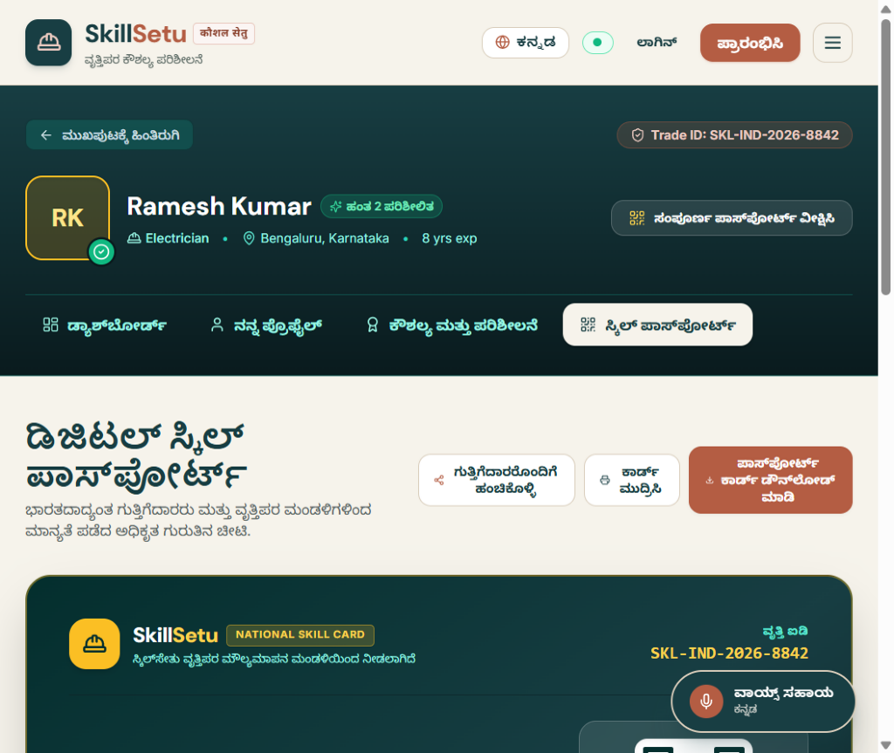
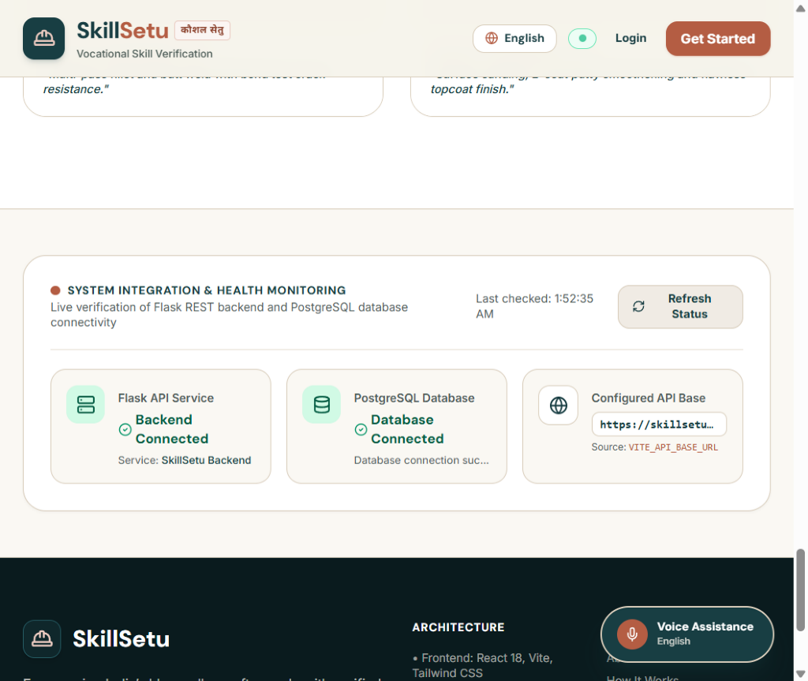
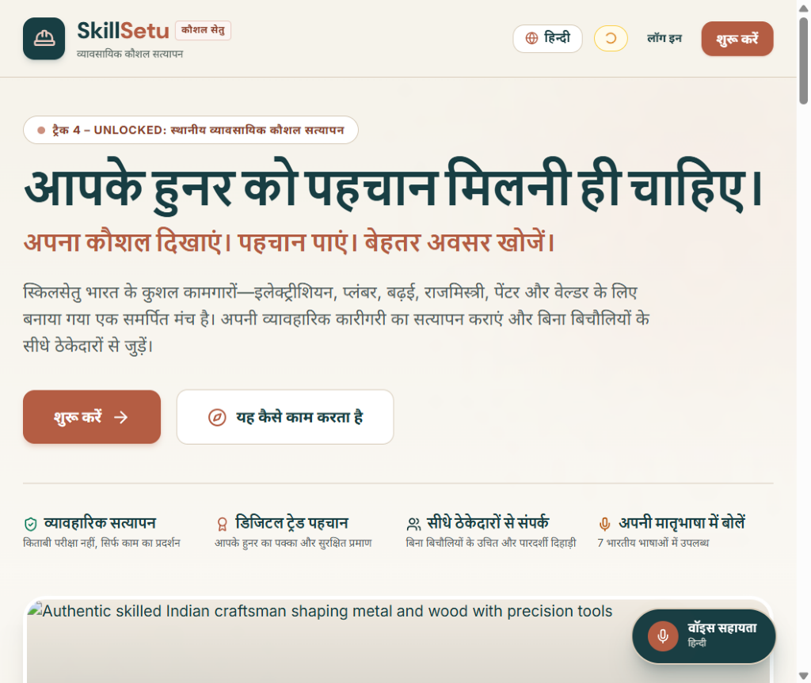
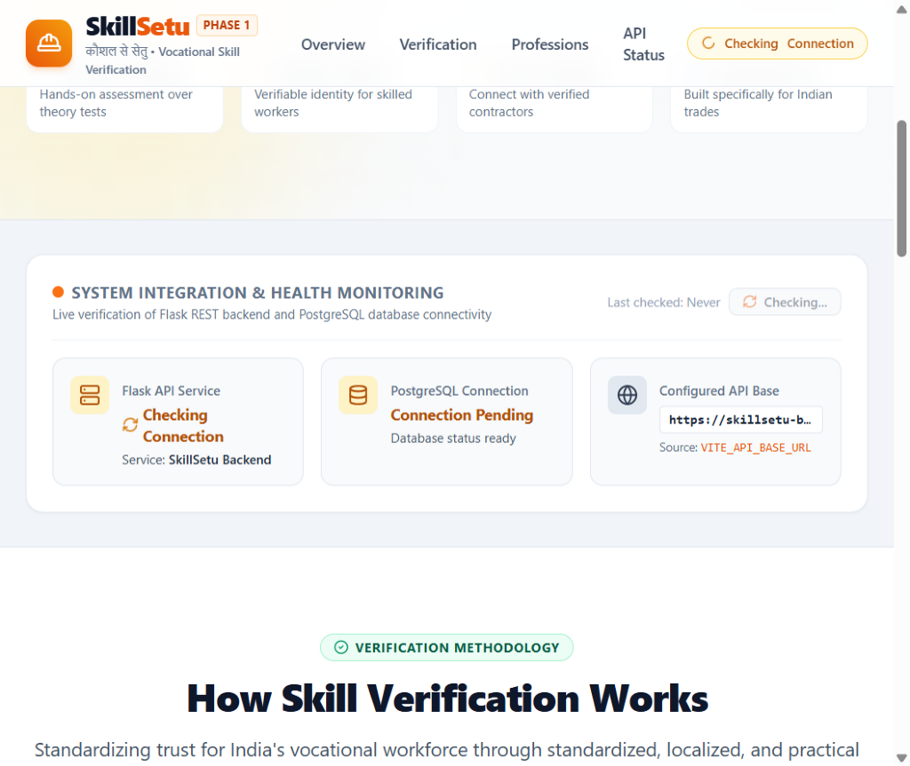
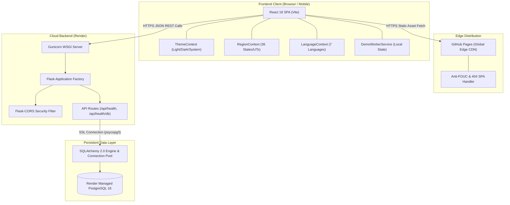

# SkillSetu (कौशल सेतु)

> **Track 4 – UnlockED: Unlocking Educational Potential, Empowering Futures**  
> *A localized, voice-assisted practical skill verification and direct employment platform for India's blue-collar workforce.*

---

[](https://github.com/ayush35099-cloud/SkillSetu/actions/workflows/deploy.yml)
[](https://skillsetu-backend-47ww.onrender.com/api/health)
[-blue?logo=postgresql&logoColor=white)](https://skillsetu-backend-47ww.onrender.com/api/health/db)
[](https://react.dev/)
[](https://vitejs.dev/)
[](https://tailwindcss.com/)
[](https://www.python.org/)
[](https://flask.palletsprojects.com/)
[](https://opensource.org/licenses/MIT)

---

## 📑 Table of Contents

- [A. Project Overview](#a-project-overview)
- [B. Live Deployments & Endpoints](#b-live-deployments--endpoints)
- [C. Problem Statement: India's Vocational Reality](#c-problem-statement-indias-vocational-reality)
- [D. Our Solution: The SkillSetu Framework](#d-our-solution-the-skillsetu-framework)
- [E. Current Implementation Status (Phases 1 & 2)](#e-current-implementation-status-phases-1--2)
- [F. Visual Showcase & Screenshots](#f-visual-showcase--screenshots)
- [G. Technology Stack](#g-technology-stack)
- [H. System Architecture](#h-system-architecture)
- [I. Project Structure](#i-project-structure)
- [J. Local Setup & Development Instructions](#j-local-setup--development-instructions)
- [K. Current Limitations & Honest Disclaimers](#k-current-limitations--honest-disclaimers)
- [L. Comprehensive 10-Phase Roadmap](#l-comprehensive-10-phase-roadmap)
- [M. Contributing, Team & Attributions](#m-contributing-team--attributions)
- [N. The SkillSetu Vision](#n-the-skillsetu-vision)

---

## A. Project Overview

**SkillSetu (कौशल सेतु)** is a dedicated digital platform built to bridge India’s massive skilled vocational workforce—electricians, plumbers, masons, carpenters, welders, painters, and mechanics—with verified, practical skill recognition and direct contractor opportunities.

Rather than relying on outdated theoretical paper examinations or inaccessible English-first portals, SkillSetu introduces:
1. **Practical-first verification** focused on demonstrated hands-on capability.
2. **Accessible, voice-guided interfaces** localized across major Indian languages.
3. **Regional trade personalisation** spanning all 36 States and Union Territories of India.
4. **Verifiable Digital Skill Passports** that workers carry anywhere.
5. **Direct contractor linkages** that eliminate exploitative middlemen and empower artisans with fair wages.

SkillSetu is entered under **Track 4 – UnlockED: Unlocking Educational Potential, Empowering Futures** for the Hackathon.

---

## B. Live Deployments & Endpoints

| Environment / Service | Provider | Status | URL |
|:---|:---|:---:|:---|
| **Production Frontend (SPA)** | GitHub Pages | Active | [https://ayush35099-cloud.github.io/SkillSetu/](https://ayush35099-cloud.github.io/SkillSetu/) |
| **Worker Portal (Interactive Demo)** | GitHub Pages | Active | [https://ayush35099-cloud.github.io/SkillSetu/worker](https://ayush35099-cloud.github.io/SkillSetu/worker) |
| **Backend REST API** | Render (Free Tier) | Active | [https://skillsetu-backend-47ww.onrender.com](https://skillsetu-backend-47ww.onrender.com) |
| **Backend Service Health Probe** | Render | Active | [https://skillsetu-backend-47ww.onrender.com/api/health](https://skillsetu-backend-47ww.onrender.com/api/health) |
| **Database Connectivity Probe** | Render PostgreSQL | Active | [https://skillsetu-backend-47ww.onrender.com/api/health/db](https://skillsetu-backend-47ww.onrender.com/api/health/db) |
| **Source Code Repository** | GitHub | Active | [https://github.com/ayush35099-cloud/SkillSetu](https://github.com/ayush35099-cloud/SkillSetu) |

> [!NOTE]  
> The backend runs on Render's free web service tier. If the service has been idle, the first request may experience a cold start latency of 45–60 seconds while the container initializes. Once awake, response latency is nominal (< 150 ms).

---

## C. Problem Statement: India's Vocational Reality

India possesses one of the world's largest vocational workforces, yet millions of skilled artisans face systematic economic marginalization:

1. **The Informal Economy Trap**: Over 90% of India's vocational craftspeople operate in the unorganized sector. Without institutional credentials, their mastery is invisible to formal institutions, banks, and major contractors.
2. **Theoretical Certification Bias**: Traditional vocational evaluation systems (e.g. standard ITI written exams) evaluate workers using pen-and-paper theory rather than inspecting their actual craftsmanship (e.g., pulling electrical conduit, cutting mortise and tenon joints, or laying precision masonry).
3. **The Linguistic & Literacy Divide**: Mainstream professional platforms (LinkedIn, Indeed) assume English fluency, desktop hardware, and high digital literacy. This excludes artisans whose primary languages are Hindi, Kannada, Bengali, Marathi, Telugu, or Tamil.
4. **Middlemen Exploitation & The Trust Deficit**: Contractors cannot easily verify the competency of independent artisans. Consequently, hiring is brokered by labour contractors (*thekedars*), who often deduct 20% to 40% of the daily wage while offering zero worker benefits or job security.

---

## D. Our Solution: The SkillSetu Framework

```
   ┌──────────────────────────────────────────────────────────────┐
   │                       SKILLSETU ECOSYSTEM                    │
   └──────────────────────────────┬───────────────────────────────┘
                                  │
         ┌────────────────────────┼────────────────────────┐
         ▼                        ▼                        ▼
┌──────────────────┐    ┌──────────────────┐    ┌──────────────────┐
│  PRACTICAL-FIRST │    │  ACCESSIBLE UX   │    │  DIRECT LINKAGE  │
│   VERIFICATION   │    │  & LOCALISATION  │    │  & FAIR WAGES    │
├──────────────────┤    ├──────────────────┤    ├──────────────────┤
│• On-site Tasks   │    │• 7 Languages     │    │• Contractor Hub  │
│• Video/Photo Evi │    │• 36 States & UTs │    │• Skill Passport  │
│• Master Rubrics  │    │• Voice Guidance  │    │• Wage Discovery  │
│• Micro-Badges    │    │• Dark/Light Mode │    │• Zero Middlemen  │
└──────────────────┘    └──────────────────┘    └──────────────────┘
```

1. **Practical Skill Demonstrations**: Real-world evaluation tasks where workers show their actual technique, safety precautions, and finished craftsmanship.
2. **Voice-Assisted, Accessible UI**: A low-friction interface designed for touch and voice on budget smartphones, localized in 7 Indian languages with intuitive iconography.
3. **Decoupled Regional Personalisation**: Complete coverage of all 36 Indian States and Union Territories + National overview, recognizing regional construction practices, material variations, and authentic Indian documentary photography.
4. **Digital Skill Passport**: A standardized, verifiable digital identity providing a breakdown of trade competencies (Master, Skilled, Semi-Skilled, Apprentice) with dynamic completion tracking.
5. **Contractor Matchmaking**: A transparent marketplace connecting verified craftspeople directly to construction projects, ensuring verified talent for builders and dignified wages for workers.

---

## E. Current Implementation Status (Phases 1 & 2)

We are committed to absolute transparency regarding what is implemented, what is an interactive demo prototype, and what is scheduled for future phases:

| Feature / Capability | Phase | Status | Technical Details / Location |
|:---|:---:|:---:|:---|
| **Flask REST Backend** | 1 | ✅ Implemented | Application factory, blueprint routing, Gunicorn WSGI (`backend/app/`) |
| **Backend Health Probe (`/api/health`)** | 1 | ✅ Implemented | JSON status report with timestamp & version (`backend/app/routes.py`) |
| **PostgreSQL DB Probe (`/api/health/db`)** | 1 | ✅ Implemented | Live `SELECT 1` query execution with connection pooling (`backend/app/routes.py`) |
| **CI/CD Deployment Pipelines** | 1 | ✅ Implemented | GitHub Actions for Pages + Render Blueprint (`render.yaml`, `deploy.yml`) |
| **SPA 404 Deep Linking Fallback** | 1 | ✅ Implemented | Vite plugin generates `404.html` copy of `index.html` for client routing |
| **Theme Engine (Light, Dark, System)** | 2 | ✅ Implemented | `ThemeContext.jsx`, zero FOUC script in `index.html`, Tailwind tokens |
| **Multilingual Engine (7 Languages)** | 2 | ✅ Implemented | English, Hindi, Kannada, Bengali, Marathi, Telugu, Tamil (`src/i18n/translations.js`) |
| **Regional Personalisation (36 States/UTs)** | 2 | ✅ Implemented | Decoupled state engine in `src/data/regions.js` & `RegionContext.jsx` |
| **Authentic Trade Photo Registry & High-Res Assets** | 2 | ✅ Implemented | Curated documentary photography with zero AI faces (`PHOTO_SOURCES.md`); 2048×1365 local WebP/JPG assets for About section |
| **Worker Experience Portal** | 2 | ✅ Implemented | Responsive sidebar/topbar layout, quick stats (`src/pages/worker/WorkerLayout.jsx`) |
| **Dynamic Profile Completion Metric** | 2 | ✅ Implemented | Dynamic calculation based on completed profile fields (`demoWorkerService.js`) |
| **Worker Profile Management** | 2 | ✅ Implemented | Interactive editing with local state persistence (`src/pages/worker/WorkerProfile.jsx`) |
| **Digital Skill Passport** | 2 | 🟡 Prototype (Demo State) | Visual credential layout with explicit demo disclaimers & non-functional QR code |
| **Practical Assessment Simulator** | 2 | 🟡 Prototype (Demo State) | Task submission UI with simulated upload & client-side status tracking |
| **Job Opportunities Board** | 2 | 🟡 Prototype (Demo State) | Filterable trade opportunity listings with instant application simulator |
| **Contractor, Assessor & Admin Portals** | 3–4 | ⏳ Planned | Clean informational coming-soon modal notices in `LoginModal.jsx` |
| **Live AI Video Evaluation (Gemini)** | 6 | ⏳ Planned | Computer vision analysis of uploaded trade technique videos |
| **Bidirectional Voice AI (Gemini Live)** | 5 | ⏳ Planned | Real-time speech-to-speech conversational assistant for unlettered workers |

---

## F. Visual Showcase & Screenshots

The platform features high-contrast accessible styling, tested across desktop and mobile viewports in Light, Dark, and System modes:

| 1. High-Contrast Dark Landing Experience | 2. Worker Portal Dashboard |
|:---:|:---:|
|  |  |
| *Hero showcase with authentic Indian documentary imagery, live health monitor, regional badge, and language selector.* | *Worker dashboard displaying dynamic completion score, assessment counts, and quick action cards.* |

| 3. Worker Profile & Dynamic Verification | 4. Verifiable Digital Skill Passport (Demo) |
|:---:|:---:|
|  |  |
| *Interactive trade profile with verified skills breakdown, experience metrics, and live field editor.* | *Transparent demo preview of the digital credential with honest prototype disclaimers.* |

> [!TIP]  
> All screenshots are tracked in the [`docs/screenshots/`](docs/screenshots/) directory.

---

## G. Technology Stack

### Frontend Architecture
- **Framework**: React 18.2 with Functional Components & Hooks
- **Build Tool**: Vite 5.0 (ESBuild bundling, Hot Module Replacement)
- **Styling**: Tailwind CSS 3.4 with custom colour tokens:
  - *Warm Ivory* (`#F6F3EB`), *Deep Teal* (`#183E43`), *Terracotta* (`#B45D43`), *Charcoal* (`#0E1D20`)
- **Icons**: Lucide React
- **Client Routing**: React Router DOM 6 with base path configuration (`/SkillSetu/`)
- **Hosting**: GitHub Pages via automated GitHub Actions CI/CD

### Backend Architecture
- **Runtime**: Python 3.11.11
- **Microframework**: Flask 3.0 (Application Factory Pattern)
- **CORS Handling**: Flask-CORS with strict origin allowlisting
- **Database ORM**: SQLAlchemy 2.0 with connection pooling
- **PostgreSQL Drivers**: Psycopg 3 (`psycopg[binary]>=3.2.3`) & Psycopg 2 (`psycopg2-binary>=2.9.9`)
- **WSGI Production Server**: Gunicorn 21.2 (2 worker processes, 4 threads, 120s timeout)
- **Hosting**: Render Managed Cloud Web Service (Free tier)

### Database Layer
- **Engine**: PostgreSQL 16 (Render Managed Database)
- **SSL Mode**: Required (`sslmode=require`)
- **Health Probing**: Sanitized `SELECT 1` queries that safely report connectivity without leaking connection strings

---

## H. System Architecture

### 1. High-Level System Architecture



### 2. Decoupled Region & Language Architecture

SkillSetu treats **Language** and **Region** as two entirely orthogonal, independent user preferences:

```
┌──────────────────────────────────────┐     ┌──────────────────────────────────────┐
│       Language Preference (7)        │     │        Region Preference (36)        │
├──────────────────────────────────────┤     ├──────────────────────────────────────┤
│ • English (en)                       │     │ • All 28 Indian States               │
│ • Hindi (hi - हिन्दी)                │     │ • All 8 Union Territories            │
│ • Kannada (kn - ಕನ್ನಡ)                │     │ • National Overview (IN-ALL)         │
│ • Bengali (bn - বাংলা)               │     │                                      │
│ • Marathi (mr - मराठी)               │     │ * Controls regional photography,     │
│ • Telugu (te - తెలుగు)               │     │   trade priorities & state hubs.     │
│ • Tamil (ta - தமிழ்)                 │     │                                      │
│                                      │     │ * Stored in:                         │
│ * Stored in:                         │     │   localStorage['skillsetu_region']   │
│   localStorage['skillsetu_language'] │     │                                      │
└──────────────────┬───────────────────┘     └──────────────────┬───────────────────┘
                   │                                            │
                   └─────────────────┬──────────────────────────┘
                                     ▼
                   ┌──────────────────────────────────┐
                   │       SkillSetu UI Shell         │
                   │ (Language + Region Intersected)  │
                   └──────────────────────────────────┘
```

> **Why this matters**: A worker living in Bengaluru (Karnataka) may be a Hindi or Bengali speaker from an interstate migration background. SkillSetu never assumes language based on state or vice versa.

---

## I. Project Structure

```
SkillSetu/
├── .github/
│   └── workflows/
│       └── deploy.yml              # GitHub Actions CI/CD to GitHub Pages
├── backend/
│   ├── app/
│   │   ├── __init__.py             # Flask app factory, CORS & blueprint setup
│   │   ├── config.py               # Environment configuration & Postgres URI handler
│   │   └── routes.py               # API health probes and root endpoints
│   ├── .env.example                # Template backend environment variables
│   ├── Procfile                    # Render process definition
│   ├── render.yaml                 # Render Infrastructure-as-Code Blueprint
│   ├── requirements.txt            # Python dependencies (Flask, SQLAlchemy, Psycopg)
│   └── run.py                      # WSGI server entry point
├── frontend/
│   ├── public/
│   │   └── vite.svg                # Brand icon
│   ├── src/
│   │   ├── components/
│   │   │   ├── Footer.jsx          # Accessible footer with links and quick stats
│   │   │   ├── Hero.jsx            # Landing hero with dynamic regional photography
│   │   │   ├── LanguageModal.jsx   # 7-language selection modal
│   │   │   ├── LoginModal.jsx      # Role selector (Worker demo vs Assessor/Contractor)
│   │   │   ├── Navbar.jsx          # Responsive header with theme, region & language controls
│   │   │   ├── Professions.jsx     # 8 vocational trades showcase with real photography
│   │   │   ├── RegionModal.jsx     # 36 States/UTs modal with live search & filter pills
│   │   │   ├── SkillVerification.jsx # 3-step practical verification methodology
│   │   │   ├── StatusIndicator.jsx # Real-time backend API & PostgreSQL health badge
│   │   │   ├── ThemeSwitcher.jsx   # Accessible Light / Dark / System theme toggle
│   │   │   └── VoiceAssistantPill.jsx # Voice assistant floating UI pill
│   │   ├── context/
│   │   │   ├── LanguageContext.jsx # Language state & translations provider
│   │   │   ├── RegionContext.jsx   # Indian state & region provider
│   │   │   └── ThemeContext.jsx    # Theme state (light/dark/system) provider
│   │   ├── data/
│   │   │   └── regions.js          # Canonical registry of all 36 States & UTs + All India
│   │   ├── i18n/
│   │   │   └── translations.js     # Comprehensive dictionary for all 7 languages
│   │   ├── pages/
│   │   │   ├── Home.jsx            # Main landing page
│   │   │   └── worker/
│   │   │       ├── WorkerAssessments.jsx # Task-based assessment simulator
│   │   │       ├── WorkerDashboard.jsx   # Worker home with dynamic completion score
│   │   │       ├── WorkerJobs.jsx        # Verified employment discovery board
│   │   │       ├── WorkerLayout.jsx      # Worker navigation shell with prototype banner
│   │   │       ├── WorkerPassport.jsx    # Digital Skill Passport with demo disclaimers
│   │   │       └── WorkerProfile.jsx     # Interactive trade profile manager
│   │   ├── services/
│   │   │   ├── api.js              # REST service for backend & database probes
│   │   │   ├── demoWorkerService.js# State service with dynamic completion score logic
│   │   │   └── photoService.js     # Authentic Indian documentary photo provider
│   │   ├── App.jsx                 # Application routes & layout provider tree
│   │   ├── index.css               # Tailwind directives & high-contrast custom variables
│   │   └── main.jsx                # SPA mount point with BrowserRouter
│   ├── .env.example                # Template frontend environment variables
│   ├── index.html                  # HTML template with Anti-FOUC theme script
│   ├── package.json                # Frontend package dependencies & build scripts
│   ├── postcss.config.js           # PostCSS configuration
│   ├── tailwind.config.js          # Custom colour palette tokens & dark mode config
│   └── vite.config.js              # Vite bundler config with 404 SPA fallback plugin
├── docs/
│   ├── screenshots/                # Application preview screenshots
│   │   ├── 01-landing-page-dark.png
│   │   ├── 02-worker-portal-dashboard.png
│   │   ├── 03-worker-profile-skills.png
│   │   └── 04-skill-passport-preview.png
│   ├── ARCHITECTURE.md             # In-depth system design & data flow document
│   ├── PHASE_STATUS.md             # Detailed audit of completed vs prototype features
│   ├── ROADMAP.md                  # Comprehensive 10-phase milestone specification
│   └── TESTING.md                  # Manual & automated QA verification checklists
├── .gitignore                      # Secrets, build artifacts, and virtualenv exclusions
├── PHOTO_SOURCES.md                # Full legal provenance & attribution for all photos
└── README.md                       # Master project documentation
```

---

## J. Local Setup & Development Instructions

### 1. Prerequisites
- **Node.js**: `v18.0.0` or higher (v20+ recommended)
- **Python**: `v3.11.x` (recommended)
- **Git**: Latest version
- **npm** or **pnpm**

---

### 2. Backend Local Setup

#### On Windows (PowerShell):
```powershell
# Navigate to backend directory
cd backend

# Create virtual environment
python -m venv venv

# Activate virtual environment
.\venv\Scripts\Activate.ps1

# Upgrade pip and install dependencies
pip install --upgrade pip
pip install -r requirements.txt

# Create local environment file
Copy-Item .env.example .env

# Run local development server
python run.py
```

#### On Linux / macOS (Bash):
```bash
# Navigate to backend directory
cd backend

# Create virtual environment
python3 -m venv venv

# Activate virtual environment
source venv/bin/activate

# Upgrade pip and install dependencies
pip install --upgrade pip
pip install -r requirements.txt

# Create local environment file
cp .env.example .env

# Run local development server
python run.py
```

The Flask server will start at: `http://localhost:5000`  
- Root API Info: `http://localhost:5000/`
- Service Health: `http://localhost:5000/api/health`
- Database Health: `http://localhost:5000/api/health/db`

---

### 3. Frontend Local Setup

```bash
# Open a new terminal and navigate to frontend directory
cd frontend

# Install dependencies
npm install

# Create local environment file
cp .env.example .env
```

Ensure `frontend/.env` contains:
```env
VITE_API_BASE_URL=http://localhost:5000
```

Start the Vite development server:
```bash
npm run dev
```

The frontend will be available at: `http://localhost:5173`

---

### 4. Production Build Verification

To verify that the frontend builds with zero syntax errors, broken imports, or missing styles:

```bash
cd frontend
npm run build
```

This generates production assets in `frontend/dist/`, including `dist/index.html` and `dist/404.html` (the SPA fallback for GitHub Pages deep linking).

---

## K. Current Limitations & Honest Disclaimers

In alignment with academic and engineering integrity for Track 4 – UnlockED, we disclose the following operational boundaries for the current Phase 2 release:

1. **Client-Side Demo State**: The Worker Portal (`/worker/*`) currently uses an in-memory and `localStorage` state provider (`demoWorkerService.js`). While workers can interactively update profiles, submit tasks, and filter jobs, records are saved in the browser session rather than a multi-tenant production user database.
2. **Prototype Skill Passport**: The Skill Passport card is a functional UX prototype. The QR code is a visual placeholder, and the digital badge does not represent an official Government of India (NSDC / NCVET) credential. Full cryptographic verification is scheduled for Phase 7.
3. **Simulated AI Services**: The video assessment submission tool and the voice pill component are prototype user interfaces. Real-time video evaluation using Google Gemini Multimodal and speech-to-speech interaction via the Gemini Live API will be implemented in Phases 5 & 6.
4. **Role Gating**: The Contractor and Assessor logins in `LoginModal.jsx` display informational banners indicating they are scheduled for Phases 3 & 4. We do not provide fake or misleading portals for these roles.
5. **Render Free Tier Dormancy**: The backend on Render automatically spins down after 15 minutes of inactivity. Initial requests after dormancy may take up to 60 seconds.

---

## L. Comprehensive 10-Phase Roadmap

| Phase | Title | Target Scope | Current Status |
|:---:|:---|:---|:---:|
| **Phase 1** | **Project Foundation & Cloud Deployment** | Flask REST API, PostgreSQL connectivity, Render backend, GitHub Pages SPA, CI/CD pipelines, live health monitoring. | ✅ **COMPLETED** |
| **Phase 2** | **UI/UX Foundation & Worker Experience** | Accessible mobile-first UI, 3-way theme engine, 7 Indian languages, 36 States/UTs personalisation, authentic Indian photo registry, Worker Portal, dynamic completion scoring, honest disclaimers. | ✅ **COMPLETED** |
| **Phase 3** | **Assessor Portal & Practical Evaluation Engine** | Independent assessor authentication, standardized hands-on rubrics for 8 trades, photographic evidence review, multi-tier scoring. | ⏳ **NEXT UP** |
| **Phase 4** | **Contractor Hub & Direct Job Marketplace** | Vetted contractor profiles, project talent requests, direct worker messaging, wage escrow protection, zero-middleman hiring. | ⏳ Planned |
| **Phase 5** | **Voice-First AI Assistant (Gemini Live API)** | Bidirectional voice navigation in 7 Indian languages for unlettered workers, audio query resolution, spoken task walkthroughs. | ⏳ Planned |
| **Phase 6** | **Automated Video Skill Analysis (Gemini Vision)** | Multimodal computer vision analysis of uploaded practical demonstration videos (e.g., verifying weld seam consistency, PPE compliance). | ⏳ Planned |
| **Phase 7** | **Tamper-Proof Digital Skill Passport** | Cryptographic verification via W3C Verifiable Credentials (VCs), decentralized identifiers (DIDs), and shareable QR validation. | ⏳ Planned |
| **Phase 8** | **Offline-First Progressive Web App (PWA)** | Service worker caching, local task drafting, offline audio instruction playback, auto-sync upon network reconnection. | ⏳ Planned |
| **Phase 9** | **Enterprise Contractor & ERP Integrations** | Construction ERP connectors, bulk site staffing APIs, automated attendance, biometric punch-in hooks. | ⏳ Planned |
| **Phase 10** | **National Skill Ecosystem Alignment** | Direct integration with National Skill Development Corporation (NSDC), Skill India Digital, and PMKVY vocational frameworks. | ⏳ Planned |

> [!NOTE]  
> For the complete, detailed breakdown of every phase, see [`docs/ROADMAP.md`](docs/ROADMAP.md).

---

## M. Contributing, Team & Attributions

### Hackathon Submission Details
- **Project**: SkillSetu (कौशल सेतु)
- **Track**: Track 4 – UnlockED: Unlocking Educational Potential, Empowering Futures
- **Repository**: [https://github.com/ayush35099-cloud/SkillSetu](https://github.com/ayush35099-cloud/SkillSetu)
- **Live Demo**: [https://ayush35099-cloud.github.io/SkillSetu/](https://ayush35099-cloud.github.io/SkillSetu/)

### Documentation Suite
- [`README.md`](README.md): Master project documentation and setup guide.
- [`docs/ARCHITECTURE.md`](docs/ARCHITECTURE.md): Deep architectural specification and data flow.
- [`docs/PHASE_STATUS.md`](docs/PHASE_STATUS.md): Exhaustive audit of Phase 1 and 2 implementation deliverables.
- [`docs/ROADMAP.md`](docs/ROADMAP.md): Detailed 10-phase milestone specification.
- [`docs/TESTING.md`](docs/TESTING.md): Manual and automated test verification matrix.
- [`PHOTO_SOURCES.md`](PHOTO_SOURCES.md): Verified provenance, licenses, and photographer credits.

### Photo Attributions
All photographs depict real Indian artisans and infrastructure projects, generously made available under the Unsplash License by Indian photographers including **Pradeep Charles**, **Naveed Ahmed**, **Ayanava Sanyal**, **Subhayan Das**, **Prasanth M**, **Anoop Kumar**, and **Ashwini Chaudhary**. See [`PHOTO_SOURCES.md`](PHOTO_SOURCES.md) for full licensing records.

---

## N. The SkillSetu Vision

> *"The true wealth of a nation is built by the hands of its artisans. When an electrician wires a hospital, a mason lays the foundation of a school, or a welder secures a bridge, they create the physical reality of modern India.  
>  
> SkillSetu exists to ensure that every skilled hand is recognized with dignity, certified by genuine capability rather than formal paper credentials, and rewarded with fair, unexploited compensation."*

---

*SkillSetu – कौशल से कामयाबी तक (From Skill to Success).*
