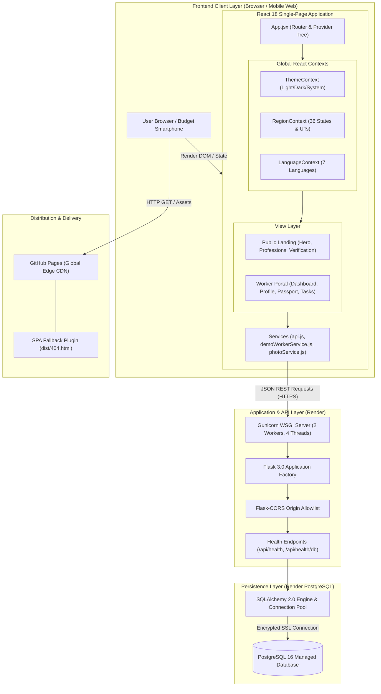
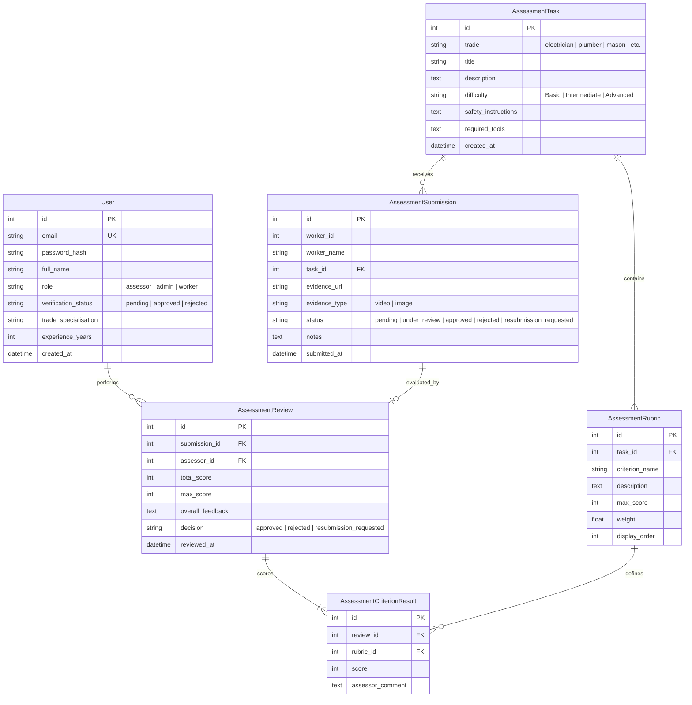
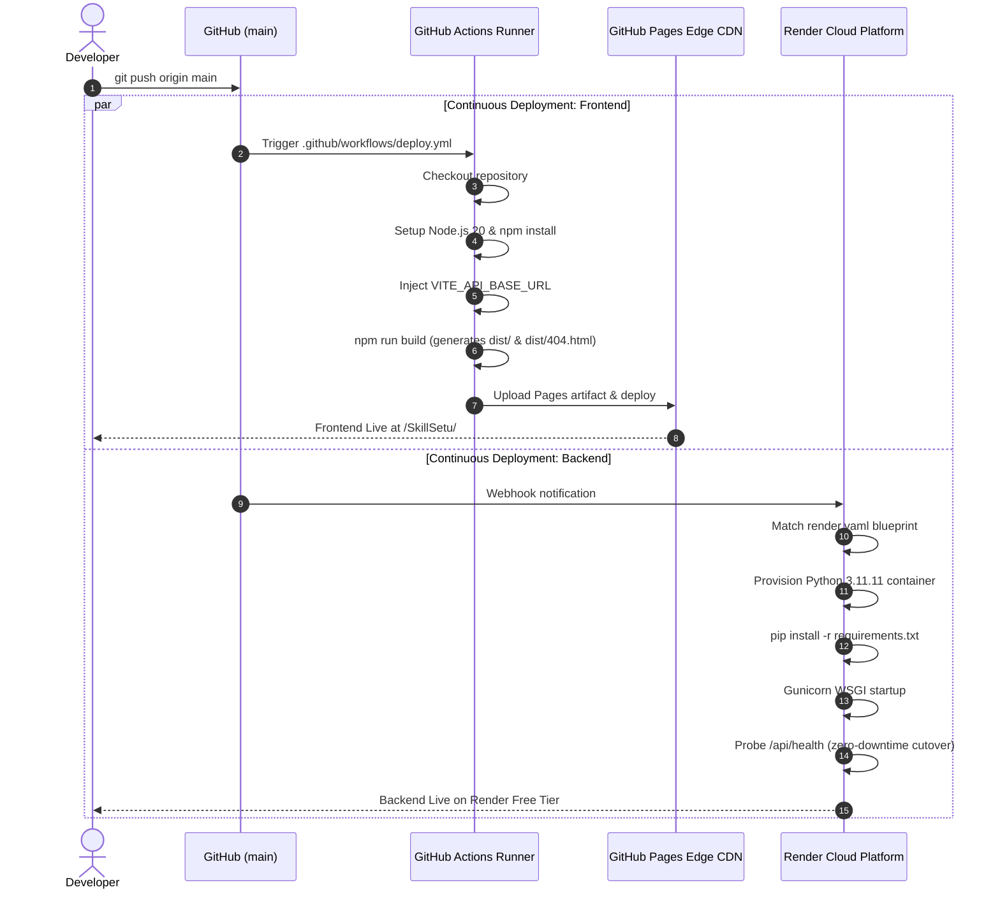

# SkillSetu – Technical Architecture & System Specifications (ARCHITECTURE.md)

> **Track 4 – UnlockED: Unlocking Educational Potential, Empowering Futures**  
> *Comprehensive architectural specification, state flow, database layer design, and deployment infrastructure.*

---

## 🏛️ System Overview

SkillSetu is designed as a decoupled, cloud-native full-stack application built for maximum accessibility, low runtime costs, and rapid scalability. The architecture is split across two core tiers:

1. **Frontend Tier**: A client-side Single-Page Application (SPA) built with React 18 and Vite, styled with Tailwind CSS, and distributed globally through GitHub Pages edge CDN.
2. **Backend Tier**: A stateless Python Flask 3.0 REST API running on a managed Render Web Service container, communicating with a managed cloud PostgreSQL database via SQLAlchemy 2.0.



---

## 💻 Frontend Architecture

### 1. Provider Tree & Context Hierarchy

To ensure instantaneous reactivity without unnecessary re-renders, contexts are layered in order of volatility:

```jsx
// Simplified Provider Nesting in App.jsx
<BrowserRouter basename="/SkillSetu">
  <ThemeProvider>          {/* 1. Theme State (light, dark, system) */}
    <RegionProvider>       {/* 2. Regional State (36 States/UTs + All India) */}
      <LanguageProvider>   {/* 3. Translation State (7 Indian languages) */}
        <AppContent />     {/* 4. Routes and UI Shell */}
      </LanguageProvider>
    </RegionProvider>
  </ThemeProvider>
</BrowserRouter>
```

#### Context Responsibilities:
- **`ThemeContext`**: Reads and writes to `localStorage['skillsetu_theme']`. Manages CSS class toggling (`dark`) on the root `document.documentElement`. Listens for OS-level `prefers-color-scheme` changes when in `system` mode.
- **`RegionContext`**: Reads and writes to `localStorage['skillsetu_region']`. Provides the active state metadata (capital, code, native name, regional trade specialties) from `regions.js`.
- **`LanguageContext`**: Reads and writes to `localStorage['skillsetu_language']`. Exposes the translation dictionary and `t(key)` accessor function with safe English fallback.

### 2. Zero-FOUC Theme Initialization

To prevent the common "flash of unstyled content" (FOUC) when loading in dark mode, an inline, synchronous JavaScript snippet executes in `<head>` before any stylesheet or React bundle loads:

```javascript
// Located in frontend/index.html <head>
(function() {
  try {
    const saved = localStorage.getItem('skillsetu_theme') || 'system';
    const prefersDark = window.matchMedia('(prefers-color-scheme: dark)').matches;
    if (saved === 'dark' || (saved === 'system' && prefersDark)) {
      document.documentElement.classList.add('dark');
    } else {
      document.documentElement.classList.remove('dark');
    }
  } catch(e) {}
})();
```

### 3. SPA Routing & 404 Deep Linking on GitHub Pages

GitHub Pages serves static files and returns a standard `404 Not Found` when a user navigates directly to or reloads a client-side route like `/SkillSetu/worker/profile`.

To solve this without external server redirects, a custom Vite build plugin clones `index.html` to `dist/404.html` on every production build:

```javascript
// Located in frontend/vite.config.js
function copyIndexTo404() {
  return {
    name: 'copy-index-to-404',
    closeBundle() {
      const distDir = resolve(__dirname, 'dist');
      const indexPath = resolve(distDir, 'index.html');
      const notFoundPath = resolve(distDir, '404.html');
      if (existsSync(indexPath)) {
        copyFileSync(indexPath, notFoundPath);
      }
    }
  };
}
```

When GitHub Pages encounters an unmatched route, it serves `404.html` (which is our React app), allowing React Router's `BrowserRouter` with `basename="/SkillSetu"` to resolve the correct view on the client side.

---

## 🎨 Design System & Accessibility

### Color Tokens
SkillSetu uses an earthy, high-contrast palette reflecting natural Indian building materials:

| Token Name | Light Mode Value | Dark Mode Value | Semantic Purpose |
|:---|:---:|:---:|:---|
| **Warm Ivory** | `#F6F3EB` | `#0E1D20` (Surface) | Primary background / Dark canvas |
| **Deep Teal** | `#183E43` | `#14292D` (Card Surface) | Brand primary / Header / Card containers |
| **Terracotta** | `#B45D43` | `#B45D43` (Vibrant) | Primary CTA buttons / Active states |
| **Sand Beige** | `#D9CDBB` | `#264950` (Border) | Secondary backgrounds / Borders |
| **Muted Sage** | `#52615C` | `#94A3B8` (Muted text) | Subtle body text / Meta tags |
| **Amber Gold** | `#D97706` | `#FBBF24` (High contrast) | Ratings, warnings, verification accents |

### Accessibility Compliance
- **WCAG AA Contrast**: All body text maintains a contrast ratio of at least `4.5:1` against adjacent background colors in both light and dark modes.
- **Focus Rings**: Interactive buttons, inputs, and modals include visible keyboard focus indicators (`focus:ring-2 focus:ring-terracotta`).
- **Touch Targets**: All mobile buttons, filter pills, and navigation links have a minimum hit area of `44px x 44px`.

---

## 🐍 Backend Architecture

### 1. Application Factory Pattern (`create_app`)

The Flask backend is structured using the modular Application Factory pattern (`backend/app/__init__.py`), enabling isolated testing and independent blueprint registration:

```python
def create_app(config_class=Config):
    app = Flask(__name__)
    app.config.from_object(config_class)

    # Initialize CORS with explicit origin allowlist
    CORS(app, origins=app.config['CORS_ORIGINS'], supports_credentials=True)

    # Register blueprints
    from app.routes import main_bp
    app.register_blueprint(main_bp)

    return app
```

### 2. Database URI Adaptation & SSL Mode

Render and various cloud providers supply PostgreSQL URLs in the legacy `postgres://` format, whereas modern SQLAlchemy 2.0 requires `postgresql://` or `postgresql+psycopg://`.

The backend includes an automatic connection URI normalizer in `backend/app/config.py`:

```python
db_url = os.environ.get('DATABASE_URL', '')
if db_url.startswith('postgres://'):
    db_url = db_url.replace('postgres://', 'postgresql://', 1)

# Enforce SSL requirement for secure cloud connections
if 'sslmode=' not in db_url and db_url.startswith('postgresql'):
    db_url += ('&' if '?' in db_url else '?') + 'sslmode=require'
```

### 3. Lightweight Health Probing

The database health check (`/api/health/db`) is designed for non-blocking probes by monitoring systems (such as Render and UptimeRobot) without placing unnecessary load on the PostgreSQL connection pool:

```python
@main_bp.route('/api/health/db', methods=['GET'])
def health_db():
    engine = get_db_engine()
    if engine is None:
        return jsonify({
            'status': 'unconfigured',
            'message': 'DATABASE_URL not configured'
        }), 200

    try:
        with engine.connect() as conn:
            conn.execute(text("SELECT 1"))
        return jsonify({
            'status': 'connected',
            'database': 'postgresql',
            'timestamp': datetime.now(timezone.utc).isoformat()
        }), 200
    except Exception as e:
        # Never leak connection credentials or stack traces
        return jsonify({
            'status': 'error',
            'database': 'postgresql',
            'error': 'Database connectivity check failed'
        }), 503
```

### 4. Phase 3 PostgreSQL Relational Schema & Assessor Engine

Phase 3 introduces a normalized PostgreSQL evaluation schema:



---

## 🚀 Deployment Pipeline & CI/CD Flow



---

*SkillSetu Architectural Specification – Track 4: UnlockED.*
